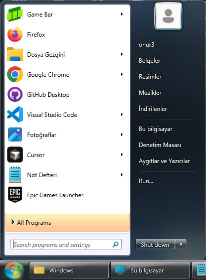
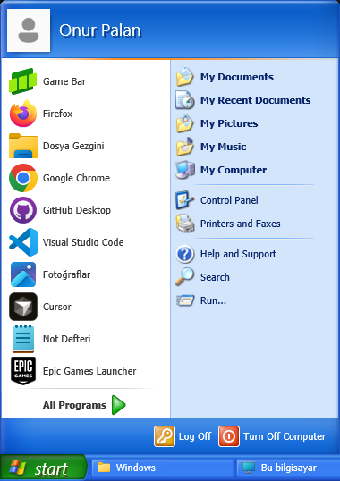
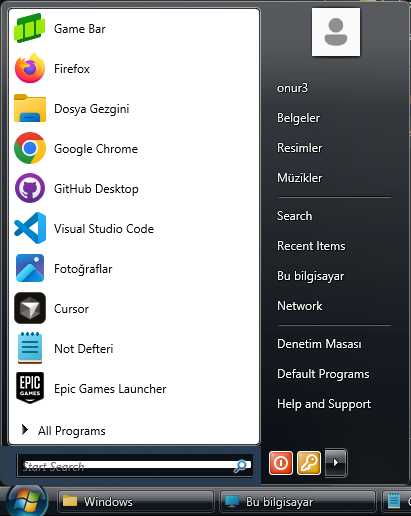
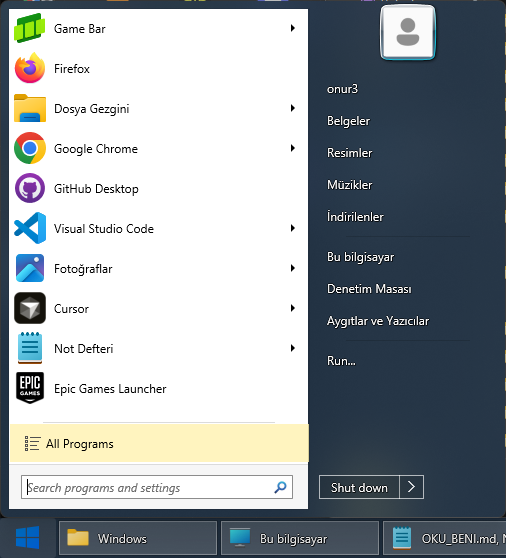
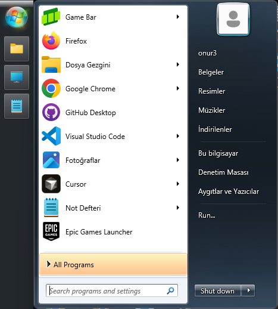
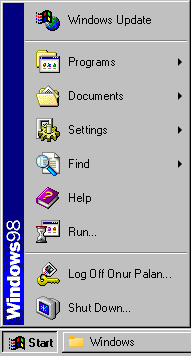

<h1 align="center">Throwback (StartAllBack alternative)</h1>

<p align="center"><b>A free, open-source StartAllBack alternative for Windows 11.</b><br>
Every Windows start menu from 98 to 11, and a classic taskbar you can put on any edge of the
screen. No ads, no trial, no account, and nothing injected into Explorer.</p>

<p align="center">
<a href="https://github.com/monurpalan/startallback-alternative/releases/latest/download/throwback.exe"><b>⬇ Download for Windows (x64)</b></a>
&nbsp;·&nbsp;
<a href="https://github.com/monurpalan/startallback-alternative/releases/latest/download/throwback-arm64.exe">ARM64</a>
&nbsp;·&nbsp;
<a href="README.tr.md">Türkçe</a>
</p>



## Install

1. **Run `throwback.exe`.** There is nothing to install: it is one file that runs for your
   Windows user, without administrator rights. It is not code-signed yet, so Windows may say
   *"Windows protected your PC"*: click **More info → Run anyway**.
2. **Pick a look.** On its first run Throwback takes the place of the Windows taskbar (it hides
   it while Throwback runs and brings it back when you exit) and opens its Properties. Choose a
   start menu and click **OK**.
3. **That's it.** Throwback now starts with Windows, with the settings you saved. The Windows
   key and Ctrl+Esc open its start menu; right-click the taskbar for everything else.

## What it does

**Start menu**

- **Eleven start menus**, each drawn from that version's original images and with its own
  Start button and taskbar: Windows 98, Me and 2000, XP, Vista, 7, Plain8 (StartAllBack's flat
  look for the Windows 7 menu), 8, 8.1, 10 and 11.
- **Put it where you like:** on the left or the right, next to the taskbar or at the top or
  bottom of the screen.
- **Shape it:** how many programs it lists, large or small icons, and which places the right
  column shows (documents, downloads, videos, recent items, network, control panel, ...).
- **Choose the Start button** for any style: the Windows 7 or Vista orb, a clover, the Windows 8
  logo or the E1even orb.
- **Like Windows 7:** frequent and pinned programs, jump lists with each program's recent
  documents, newly installed programs highlighted until you start them, and a right-click menu
  (run as administrator, open file location, pin).
- **Search** that ignores case and accents, Turkish letters included, and finds Settings pages
  too.

**Taskbar**

- **On any edge.** On the left or right it stands upright with one square tile per window, the
  clock and date, a bell for the notification center and a show desktop strip, as on
  StartAllBack.
- **One button per window** with its icon and title, never combined; click the active one to
  minimize.
- **Live previews** on hover, the classic window menu on right-click, flashing buttons for
  windows that need you, and the progress and overlay icons programs set.
- **The notification area** with every program's icons; drag an icon off the bar to hide it
  behind the arrow, or back onto it.
- **Clock and calendar:** click the clock for the calendar.
- **A bar on every monitor**, each with the windows on that monitor.
- **Quick changes:** right-click the taskbar to switch the start menu, the Start button or the
  menu's side without opening Properties.

**Everywhere**

- **English and Turkish**, following the Windows display language.
- **Light and dark** menus following Windows, or forced either way.
- **Starts with Windows**, sharp on every display (per-monitor DPI), and steps aside for
  fullscreen games and videos.

| | |
|---|---|
|  |  |
|  |  |

<p align="center"></p>

## How it compares

As each project describes itself:

| | Throwback | StartAllBack | Open-Shell | ExplorerPatcher |
|---|---|---|---|---|
| Price | Free | Paid, with a trial | Free | Free |
| Source code | Open (MIT) | Closed | Open (MIT) | Open (GPL-2.0) |
| How it works | Its own taskbar and start menu, next to Explorer | Loads into Explorer | Loads into Explorer | Loads into Explorer |
| Start menus | 98, Me, 2000, XP, Vista, 7, Plain8, 8, 8.1, 10, 11 | Windows 7 style, with themes | Classic, two columns, Windows 7 | Windows 10 |

Because Throwback never patches Explorer, a Windows update cannot break Explorer through it and
a bug in Throwback cannot take Explorer down. The price is that some things Explorer gives for
free are rebuilt, such as the notification area.

## Questions

**Is it related to StartAllBack?** No. Throwback is an independent project, not affiliated with
StartAllBack or Microsoft; the name only says what it is an alternative to. The Plain8 look and
the clover, Windows 8 and E1even orbs come from StartAllBack's theme files, and the Windows
images from Windows itself (see the READMEs in [assets](assets)).

**Is it safe?** The code is open, every release is built from it on GitHub, and the release
lists the SHA-256 of each file in `SHA256SUMS`. It needs no administrator rights and changes
nothing in Windows' own files.

**Where are my settings?** In the registry, under `HKEY_CURRENT_USER\Software\Throwback`.

**How do I remove it?** Right-click the taskbar, untick *Start Throwback with Windows*, choose
*Exit Throwback* (the Windows taskbar comes back), and delete `throwback.exe`.

**Something does not work.** Please
[open an issue](https://github.com/monurpalan/startallback-alternative/issues) with what you did
and what happened.

## Command line

| Option | |
|---|---|
| `--edge=top\|bottom\|left\|right` | Where the taskbar docks |
| `--start-style=98\|me\|2000\|xp\|vista\|7\|plain8\|8\|8.1\|10\|11` | The start menu |
| `--theme=system\|light\|dark` | Menu colors |
| `--lang=en\|tr` | Language |
| `--profile=<name>` | A separate set of saved settings |

Options apply to one run and are not saved.

## Building

Visual Studio 2022 (or its Build Tools) with the C++ workload, the Windows SDK 10.0.22621 or
newer, and CMake 3.25 or newer:

```bash
cmake --preset msvc
cmake --build --preset release
```

The program is `build/msvc/Release/throwback.exe`. How the pieces fit together is in
[docs/ARCHITECTURE.md](docs/ARCHITECTURE.md).

## License

[MIT](LICENSE)
