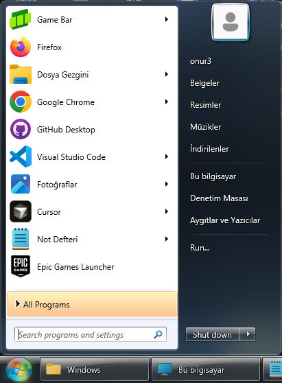
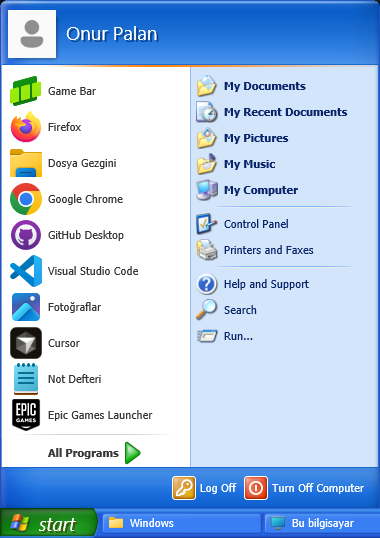
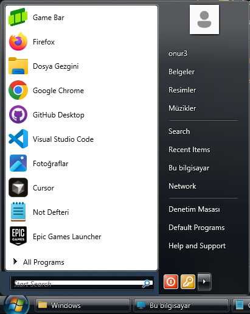
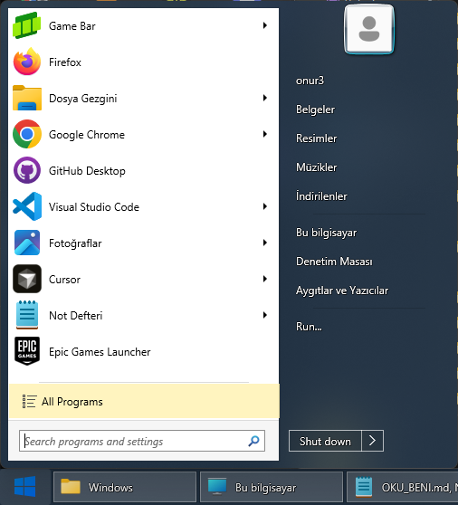
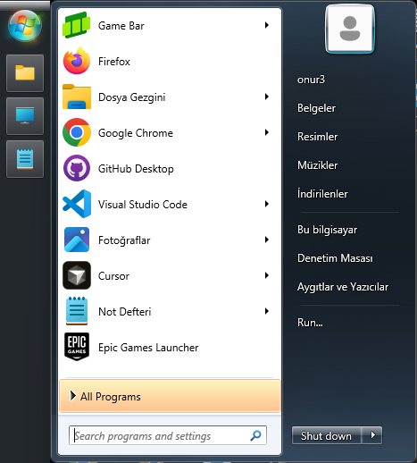
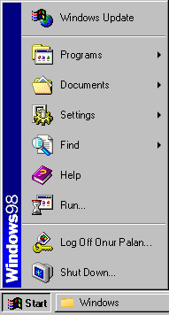

<h1 align="center">Throwback (StartAllBack alternatifi)</h1>

<p align="center"><b>Windows 11 için ücretsiz, açık kaynak bir StartAllBack alternatifi.</b><br>
Windows 98'den 11'e her Başlat menüsü ve ekranın istediğin kenarına koyabileceğin klasik bir
görev çubuğu. Reklam yok, deneme süresi yok, hesap yok; Explorer'ın içine hiçbir şey enjekte
edilmez.</p>

<p align="center">
<a href="https://github.com/monurpalan/startallback-alternative/releases/latest/download/throwback.exe"><b>⬇ Windows için indir (x64)</b></a>
&nbsp;·&nbsp;
<a href="https://github.com/monurpalan/startallback-alternative/releases/latest/download/throwback-arm64.exe">ARM64</a>
&nbsp;·&nbsp;
<a href="README.md">English</a>
</p>



## Kurulum

1. **`throwback.exe`'yi çalıştır.** Kurulacak bir şey yok: yönetici izni istemeden senin Windows
   kullanıcın için çalışan tek bir dosya. Henüz kod imzalı olmadığı için Windows *"Windows
   bilgisayarınızı korudu"* diyebilir: **Ek bilgi → Yine de çalıştır**'a tıkla.
2. **Bir görünüm seç.** İlk açılışta Throwback, Windows görev çubuğunun yerine geçer (Throwback
   çalışırken onu gizler, çıkınca geri getirir) ve Özellikler penceresini açar. Bir Başlat menüsü
   seçip **Tamam**'a tıkla.
3. **Bu kadar.** Throwback artık kaydettiğin ayarlarla Windows'la birlikte açılır. Windows tuşu
   ve Ctrl+Esc onun Başlat menüsünü açar; geri kalan her şey görev çubuğunun sağ tık menüsünde.

## Neler yapar

**Başlat menüsü**

- **On bir Başlat menüsü**, her biri o sürümün özgün görselleriyle, kendi Başlat düğmesi ve
  görev çubuğuyla: Windows 98, Me ve 2000, XP, Vista, 7, Plain8 (StartAllBack'in Windows 7 menüsü
  için düz görünümü), 8, 8.1, 10 ve 11.
- **İstediğin yerde:** solda ya da sağda, görev çubuğunun yanında ya da ekranın üstünde veya
  altında.
- **İstediğin biçimde:** kaç program listeleneceği, büyük ya da küçük simgeler ve sağ sütunda
  hangi yerlerin görüneceği (belgeler, indirilenler, videolar, son öğeler, ağ, denetim masası, ...).
- **Başlat düğmesini seç**, her görünümde: Windows 7 ya da Vista küresi, yonca, Windows 8 logosu
  veya E1even küresi.
- **Windows 7'deki gibi:** sık kullanılan ve sabitlenen programlar, her programın son
  belgeleriyle atlama listeleri, açılana kadar vurgulanan yeni yüklenen programlar ve sağ tık
  menüsü (yönetici olarak çalıştır, dosya konumunu aç, sabitle).
- **Arama** büyük-küçük harfe ve aksanlara takılmaz, Türkçe harfler dahil; Ayarlar sayfalarını da
  bulur.

**Görev çubuğu**

- **Her kenarda.** Solda ya da sağda dik durur: her pencere için bir kare, saat ve tarih,
  bildirim merkezi için bir zil ve Masaüstünü göster şeridi; StartAllBack'teki gibi.
- **Her pencereye bir düğme**, simgesi ve başlığıyla, asla birleştirilmez; etkin olana tıklamak
  küçültür.
- **Canlı önizlemeler**, sağ tıkta klasik pencere menüsü, ilgi bekleyen pencereler için yanıp
  sönen düğmeler ve programların gösterdiği ilerleme ile simge rozetleri.
- **Bildirim alanı** tüm programların simgeleriyle; bir simgeyi çubuktan sürükleyip okun arkasına
  gizle ya da geri getir.
- **Saat ve takvim:** takvim için saate tıkla.
- **Her monitörde bir çubuk**, her biri o monitördeki pencerelerle.
- **Arama ve Görev Görünümü düğmeleri** Başlat'ın yanında ve Explorer'ın kendi sağ tık menüsü:
  Masaüstünü göster, Görev Yöneticisi, görev çubuğunu kilitle (kilit açıkken başka kenara sürükle).
- **Hızlı değişiklik:** Özellikler'i açmadan, sağ tıkla Başlat menüsünü, Başlat düğmesini ya da
  menünün tarafını değiştir.

**Her yerde**

- **Türkçe ve İngilizce**, Windows'un görüntüleme dilini izler.
- **Açık ve koyu** menüler, Windows'a uyar ya da birine sabitlenir.
- **Windows'la açılır**, her ekranda keskin görünür (monitör başına DPI) ve tam ekran oyun ile
  videolarda kenara çekilir.

| | |
|---|---|
|  |  |
|  |  |

<p align="center"></p>

## Diğerleriyle karşılaştırma

Her projenin kendini tanıttığı haliyle:

| | Throwback | StartAllBack | Open-Shell | ExplorerPatcher |
|---|---|---|---|---|
| Fiyat | Ücretsiz | Ücretli, deneme sürümlü | Ücretsiz | Ücretsiz |
| Kaynak kod | Açık (MIT) | Kapalı | Açık (MIT) | Açık (GPL-2.0) |
| Nasıl çalışır | Explorer'ın yanında kendi görev çubuğu ve Başlat menüsü | Explorer'ın içine yüklenir | Explorer'ın içine yüklenir | Explorer'ın içine yüklenir |
| Başlat menüleri | 98, Me, 2000, XP, Vista, 7, Plain8, 8, 8.1, 10, 11 | Windows 7 tarzı, temalarla | Klasik, iki sütunlu, Windows 7 | Windows 10 |

Throwback Explorer'a hiç dokunmadığı için bir Windows güncellemesi onun yüzünden Explorer'ı
bozamaz, Throwback'teki bir hata da Explorer'ı çökertemez. Bunun bedeli, Explorer'ın hazır
verdiği bazı parçaların (bildirim alanı gibi) yeniden yazılması.

## Sorular

**StartAllBack'le bir bağı var mı?** Hayır. Throwback bağımsız bir proje; StartAllBack ya da
Microsoft ile ilişkisi yok, adı yalnızca neyin alternatifi olduğunu söylüyor. Plain8 görünümü ile
yonca, Windows 8 ve E1even küreleri StartAllBack'in tema dosyalarından, Windows görselleri
Windows'un kendisinden alındı (bkz. [assets](assets) içindeki README'ler).

**Güvenli mi?** Kod açık, her sürüm GitHub'da bu koddan derleniyor ve sürümde her dosyanın
SHA-256'sı `SHA256SUMS` içinde yazıyor. Yönetici izni istemez, Windows'un kendi dosyalarında
hiçbir şeyi değiştirmez.

**Ayarlarım nerede?** Kayıt defterinde, `HKEY_CURRENT_USER\Software\Throwback` altında.

**Nasıl kaldırırım?** Görev çubuğuna sağ tıkla, *Windows açılınca başlat*'ın işaretini kaldır,
*Throwback'ten çık*'ı seç (Windows görev çubuğu geri gelir) ve `throwback.exe`'yi sil.

**Bir şey çalışmıyor.** Ne yaptığını ve ne olduğunu yazarak bir
[issue aç](https://github.com/monurpalan/startallback-alternative/issues).

## Komut satırı

| Seçenek | |
|---|---|
| `--edge=top\|bottom\|left\|right` | Görev çubuğunun kenarı |
| `--start-style=98\|me\|2000\|xp\|vista\|7\|plain8\|8\|8.1\|10\|11` | Başlat menüsü |
| `--theme=system\|light\|dark` | Menü renkleri |
| `--lang=en\|tr` | Dil |
| `--profile=<ad>` | Ayrı bir kayıtlı ayar takımı |

Seçenekler yalnızca o açılış için geçerlidir, kaydedilmez.

## Derleme

C++ iş yüküyle Visual Studio 2022 (ya da Build Tools), Windows SDK 10.0.22621 veya üstü ve CMake
3.25 veya üstü:

```bash
cmake --preset msvc
cmake --build --preset release
```

Program `build/msvc/Release/throwback.exe` konumunda olur. Parçaların nasıl bir araya geldiği
[docs/ARCHITECTURE.md](docs/ARCHITECTURE.md) içinde.

## Lisans

[MIT](LICENSE)
